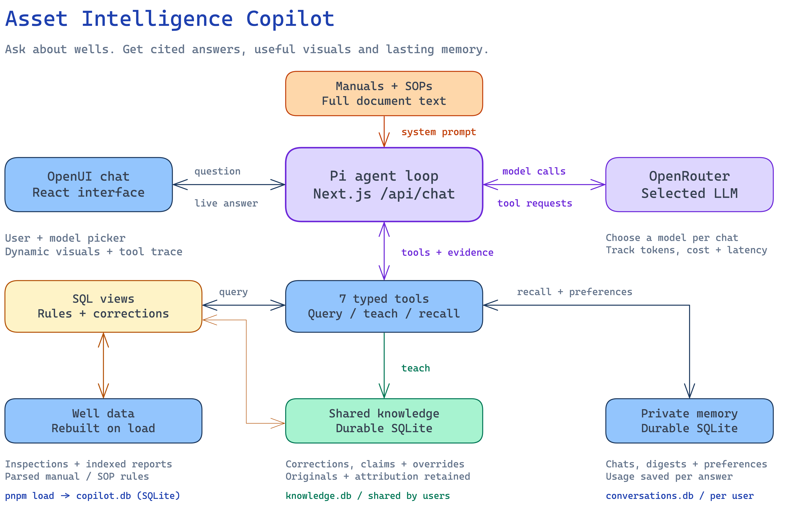

# Asset Intelligence Copilot

[Two-page write-up](../output/pdf/industry-copilot-writeup.pdf) | [Full answers PDF](../output/pdf/industry-copilot-submission.pdf) | [Runbook and five-minute video outline](RUNBOOK.md)

The two-page write-up contains system design and the results discussion below. Full, ungraded agent answers are preserved separately in [Markdown](../output/answers/final-answers.md) and the companion PDF. Evaluation history is separate from this answer capture.

## System design

**Pi + runtime tools.** One Pi agent per user/conversation runs the model-tool-result loop at `/api/chat`. Five fleet tools handle snapshots, read-only SQL, report search/read and shared knowledge; two user-bound tools manage recall and preferences. Pi executes model-chosen calls and arguments, streaming results into the visible tool trace.

**Dynamic visuals.** OpenUI renders cited cards, tables, charts, maps and heatmaps. For custom requests, the model generates a Vega-Lite `Plot`: threshold lines, highlighted readings, timelines or layered charts. Follow-ups reshape the previous visual using the same data; map styles and palettes are configurable.

**Manuals and SOPs: two paths.** Full document text enters the system prompt with the glossary, view schema and user context. Parsed rules also drive SQLite views for production, downtime, spill classes and compliance. SQL calculates; answers cite the governing document section.

**Evidence storage.** Three SQLite files separate rebuildable fleet data, shared knowledge and private conversations. FTS5 searches repair reports; tools return snippets, full text and extracted containment/compliance facts alongside structured records and operational notes.

**Shared learning and conflicts.** Corrections retain original values, replacements, author and reason. Accepted corrections and well-type overrides update everyone's derived results at their exact scope. Contradicted claims remain unconfirmed; disputed notes preserve both accounts. Knowledge survives dataset reloads.

**Private, durable memory.** Pi holds live state in RAM; SQLite saves transcripts, answer digests and usage after each turn. New chats receive up to 15 of that user's recent digests. `recall_my_conversations` searches older digests or reads original answers for ordered selections. Missing matches require clarification. Saved transcripts resume after restarts.

**Personal preferences.** `my_preferences` saves, lists, replaces or removes private presentation rules across chats, such as "always use red for wellhead temperature". A one-off request takes precedence without changing standing preferences or shared well facts.

**Models, cost and new data.** OpenRouter offers five models, defaulting to GPT-6 Luna; conversations keep their model. Per-answer tokens, cost and latency cover every model call. Dataset roots merge by ID, later roots win, and missing required manual rules fail the load explicitly.

**Next improvements.** Compact long active transcripts, retrieve manual sections for larger corpora, and add authenticated identity beyond the demo user picker.

## Results: final questions

GPT-6 Luna answered all 11 numbered questions (21 turns) on the 600-well test dataset, as of 15 January 2027, preserving the prescribed user/session sequence. These are actual agent responses, not corrected reference answers. No grader or scores were used for this capture. Completed turns report $0.36 in model usage; this excludes interrupted requests and is not a billing reconciliation.

| Question | Observed answer and limitation |
| --- | --- |
| Q1. Reservoir pressure | Declined to invent a pressure map because the records contain temperatures, not reservoir pressure. |
| Q2. Best producer | Distinguished missing oil volumes from an inspection-count proxy; the proxy cannot identify a unique top producer. |
| Q3. Gas reports | Produced dated response/deadline evidence; completeness and first-response timestamp matching remain weak. |
| Q4. Bypasses | Joined notes and approval memos into a status table; historical intervals and extensions need deterministic validation. |
| Q5. Regulator letter | Cited sampling evidence, but some compliance reasons contradict their quoted reports. |
| Q6. Status conflicts | Compared inspection and operator-note evidence; imported correction handling and precedence are not consistently reliable. |
| Q7. Maintenance priorities | Quoted warning notes and ranked candidates, then selected three; some listed wells already have repairs, weakening the required filter. |
| Q8. Attribution and recall | Exercised shared replacement reports and private preferences; the pump inventory contains duplicates and replaced pumps, with inconsistent attribution. |
| Q9. Conversation continuity | Returned to earlier subjects and declined to invent an H2S reading; team-lead lookup and cross-topic evidence remain incomplete. |
| Q10. Delay reasons | Explicitly limited the answer to report-verified examples and declined a misleading fleet-wide chart; complete aggregation is unsupported. |
| Q11. Regional heat | Compared raw temperatures and ambient conditions; a complete within-well-type, month-by-month comparison is missing. |

**What worked.** Evidence-bearing tables, durable user/session continuity, provenance and honest refusals for missing measurements. All full responses are retained for inspection, including their errors.

**What did not, and why.** Views do not fully handle historical well-type changes or dataset-labelled corrections. Relevance-ranked report search is not an exhaustive aggregation interface. Long model investigations still omit evidence, mishandle inventories and fail some requested visuals. Stronger instructions did not remove these data/tool limits.

**Next changes.** Apply type history and imported corrections in shared data logic; extract installed-pump history and delay reasons into queryable fields; add deterministic checks for status precedence, time windows and list completeness. Keep presentation preferences private and operational claims attributed.
